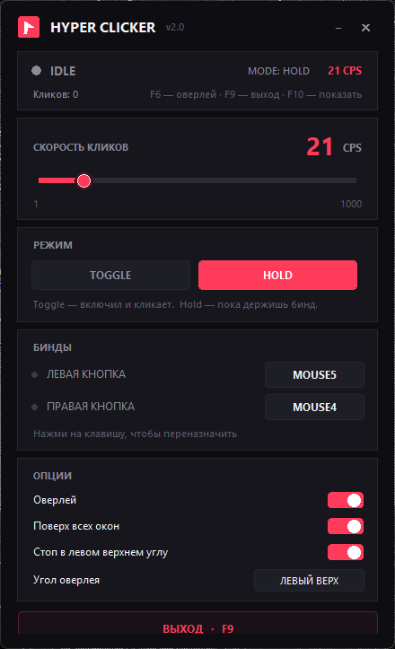
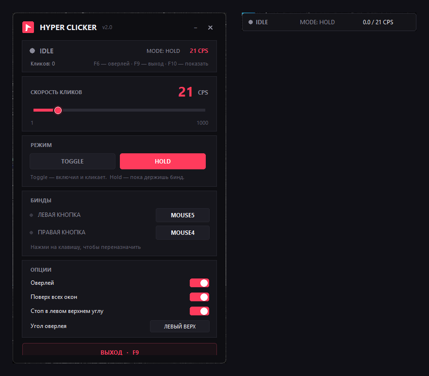

# HYPER CLICKER

Автокликер для Windows с тёмным интерфейсом, глобальными горячими клавишами
и оверлеем. Работает на чистом Python — сторонние библиотеки не нужны.

## Скриншоты

Главное окно:



Работающий кликер с оверлеем (оно же крупно — [overlay](docs/screenshots/overlay.png)):



## Скачать

Готовый **`HYPER CLICKER.exe`** лежит в [релизах](../../releases) —
запускается двойным кликом, Python и установка зависимостей не нужны.

## Что умеет

- **Скорость 1–1000 CPS** — слайдер + точный ввод с клавиатуры.
- **Два независимых бинда** — левая и правая кнопка мыши.
- **Переназначение биндов** — на любую клавишу или Mouse4/Mouse5.
- **Режимы**:
  - `Toggle` — нажал бинд и клики идут до повторного нажатия;
  - `Hold` — клики идут, пока бинд удерживается.
- **Оверлей** поверх всех окон: `IDLE/ACTIVE · MODE · SPEED`, не перехватывает клики.
- **Аварийная остановка** — уведи курсор в левый верхний угол.
- **Сохранение настроек** между запусками.
- Окно перетаскивается за заголовок, сворачивается кнопкой **«—»**,
  возвращается клавишей **F10** или кликом по иконке в панели задач.
- Защита от случайного запуска второго экземпляра.

## Готовый exe

- Настройки exe хранятся в `%APPDATA%\HyperClicker\settings.json`.
- Собрать exe заново:

```powershell
python -m pip install pyinstaller
python -m PyInstaller --noconfirm --clean --onefile --windowed --name "HYPER CLICKER" --icon app.ico --add-data "app.ico;." clicker.py
```

## Запуск из исходников

Двойной клик по **`start.bat`** или из консоли:

```powershell
pythonw clicker.py
```

Если нужен вывод ошибок в консоль:

```powershell
python clicker.py
```

Сбросить настройки:

```powershell
python clicker.py --reset-settings
```

## Управление по умолчанию

| Действие | Клавиша |
| --- | --- |
| Левая кнопка мыши (старт/пауза в Toggle) | **F8** |
| Правая кнопка мыши (старт/пауза в Toggle) | **Mouse4** (боковая кнопка) |
| Свернуть окно | кнопка **«—»** в заголовке |
| Показать свёрнутое окно | **F10** или иконка в панели задач |
| Выход | **F9** |
| Аварийная остановка | курсор в левый верхний угол |

При сворачивании кликер и оверлей продолжают работать.

Бинды переназначаются прямо в приложении: нажми на чип `F8` / `MOUSE4`,
затем нажми нужную клавишу (Esc — отмена).

## Файлы

| Файл | Назначение |
| --- | --- |
| `clicker.py` | GUI-версия (основная) |
| `autoclicker.py` | консольная версия без интерфейса |
| `start.bat` | запуск GUI без окна консоли |
| `app.ico` | иконка приложения |
| `settings.json` | настройки исходной версии |
| `README.md` | эта инструкция |

`HYPER CLICKER.exe` хранит настройки отдельно,
в `%APPDATA%\HyperClicker\settings.json`.

## Требования

- Windows 10/11.
- Для exe — больше ничего.
- Для запуска из исходников — Python 3.10+ с tkinter
  (идёт в комплекте с python.org).

## Примечания

- Бинды работают глобально, даже когда окно кликера не в фокусе.
- Некоторые игры с античит-защитой блокируют синтетические клики.
- Если целевое приложение запущено от администратора, кликер тоже нужно
  запустить от администратора.
- Mouse4/Mouse5 могут дополнительно срабатывать в браузере (навигация назад) —
  приложение не перехватывает ввод, а только читает состояние клавиш.
- Реальная скорость выше ~500 CPS зависит от нагрузки на систему.
